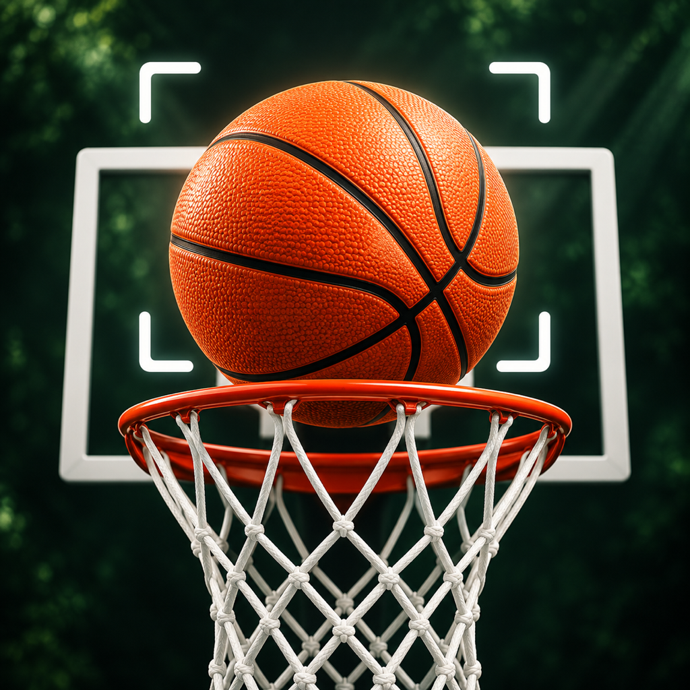
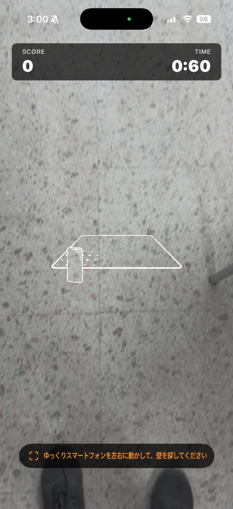
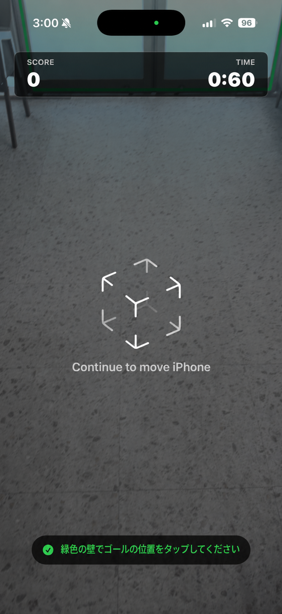
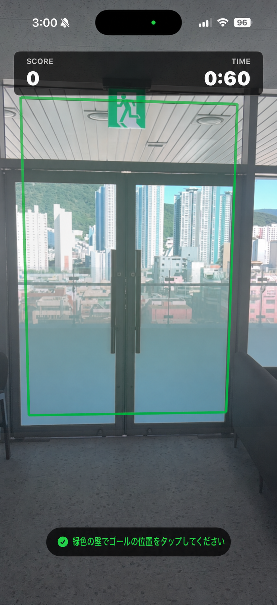
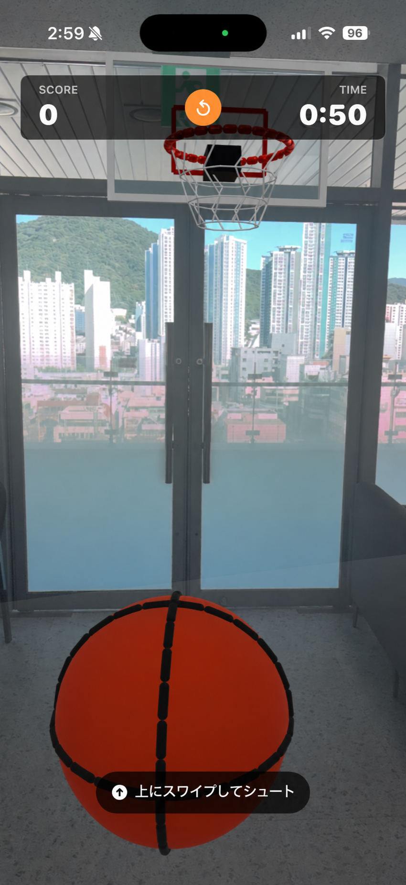

# AR Basket

[日本語](README.ja.md) · [English](README.md) · [한국어](README.ko.md)

SwiftUI、ARKit、RealityKitで作られたiOS拡張現実バスケットボールゲームMVPです。

## アプリアイコン

  

## ゲーム画面

|ウォールスキャン|位置情報|壁検出|ゲームプレイ|
| --- | --- | --- | --- |
|  |  |  |  |

## 主な機能

- 実際の垂直壁認識と骨格の配置
- 認識された壁の可視化とARスキャンガイド
- スワイプ方向と速度を反映したシュート
- バスケットボール、ゴール、バックボードの物理衝突
- リング通過得点判定
- スコアボードと60秒タイマー
- ゴールポジションを再指定できる再起動機能
- 初心者のためのシュート補正と広いスコア範囲

## 要件

- Xcode 16以上
- iOS 17以降
- ARKitをサポートする実際のiPhoneまたはiPad
- カメラ権限

ARゲームはシミュレータでプレイできません。ビルドといくつかのテストは可能ですが、実際のプレイにはARKit対応デバイスが必要です。

## 実行方法

1.カメラを壁に向けてゆっくりと左右に動かします。
2.緑色で表示された壁またはARKitが推定した壁をタップしてスケルトンを配置します。
3. 画面を上にスワイプしてボールを投げます。

## 操作方法

- **スティックの配置：**認識された壁をタップします。
- **シュート：**画面を上にスワイプします。
- **再起動：**上部スコアボードの小さな再起動ボタンを押してから、壁をもう一度タップします。

## 技術構成

- Swift
- SwiftUI
- ARKit
- RealityKit
- XCTest

外部ライブラリは使用しません。
