# AR Basket

[日本語](https://github.com/hjy0221/ARBasket#%E6%97%A5%E6%9C%AC%E8%AA%9E) · [English](https://github.com/hjy0221/ARBasket#english) · [한국어](https://github.com/hjy0221/ARBasket#%ED%95%9C%EA%B5%AD%EC%96%B4)

## 日本語

SwiftUI、ARKit、RealityKitで作られたiOS拡張現実バスケットボールゲームMVPです。

## アプリアイコン

  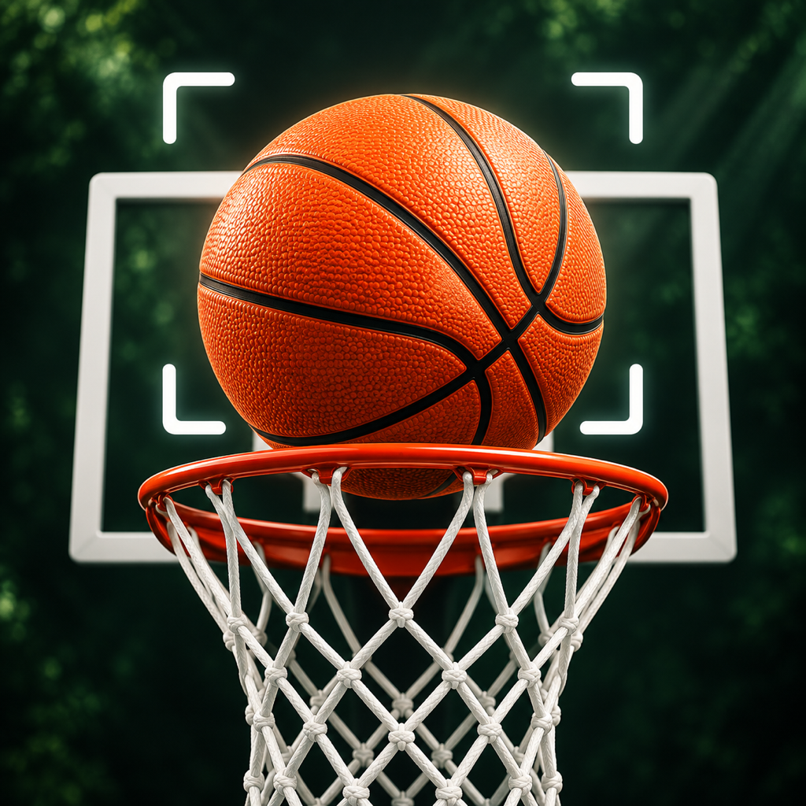

## ゲーム画面

|ウォールスキャン|位置情報|壁検出|ゲームプレイ|
| --- | --- | --- | --- |
| 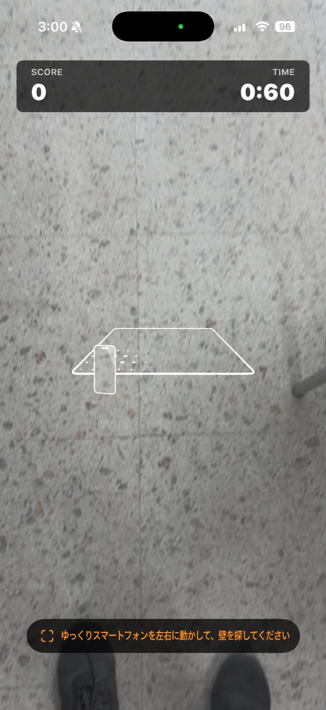 | 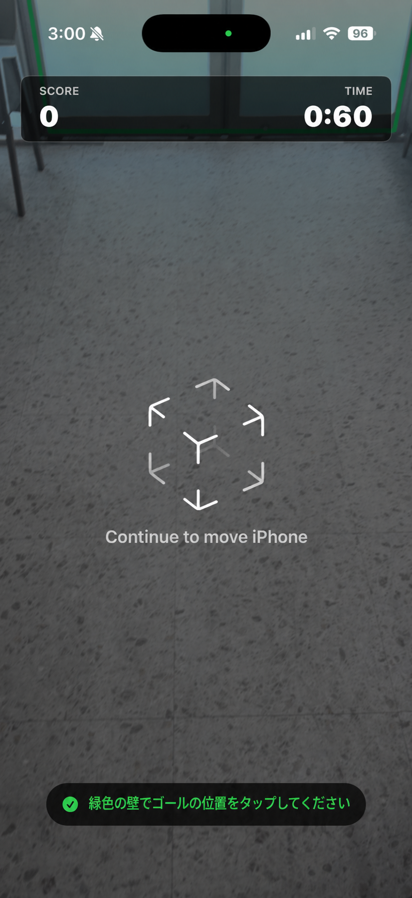 | 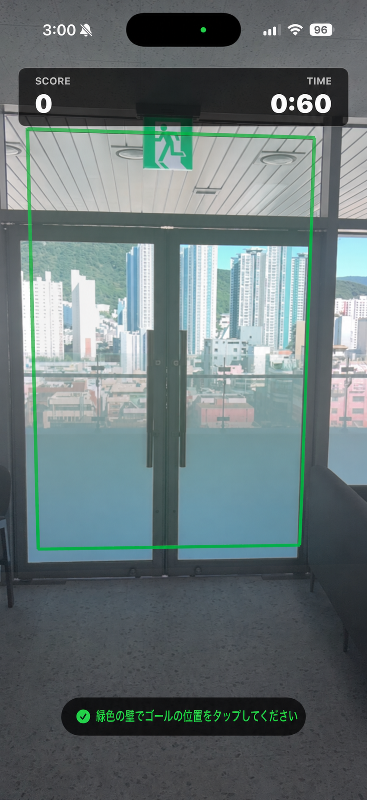 | 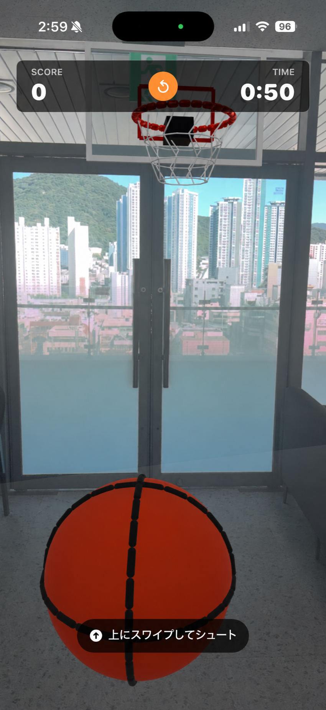 |

## 主な機能

- 実際の垂直壁認識と骨格の配置
- 認識された壁の可視化とARスキャンガイド
- スワイプ方向と速度を反映したシュート
- バスケットボール、ゴール、バックボードの物理衝突
- リング通過得点判定
- スコアボードと60秒タイマー
- ゴールポジションを再指定できる再起動機能
- 初心者のためのシュート補正と広いスコア範囲

## 要件

- Xcode 16以上
- iOS 17以降
- ARKitをサポートする実際のiPhoneまたはiPad
- カメラ権限

ARゲームはシミュレータでプレイできません。ビルドといくつかのテストは可能ですが、実際のプレイにはARKit対応デバイスが必要です。

## 実行方法

1.カメラを壁に向けてゆっくりと左右に動かします。
2.緑色で表示された壁またはARKitが推定した壁をタップしてスケルトンを配置します。
3. 画面を上にスワイプしてボールを投げます。

## 操作方法

- **スティックの配置：**認識された壁をタップします。
- **シュート：**画面を上にスワイプします。
- **再起動：**上部スコアボードの小さな再起動ボタンを押してから、壁をもう一度タップします。

## 技術構成

- Swift
- SwiftUI
- ARKit
- RealityKit
- XCTest

外部ライブラリは使用しません。

## English

This is an iOS augmented reality basketball game MVP created with SwiftUI, ARKit, and RealityKit.

## App icon

  

## Game screen

| wall scan | Location information | wall detection | Gameplay |
| --- | --- | --- | --- |
| 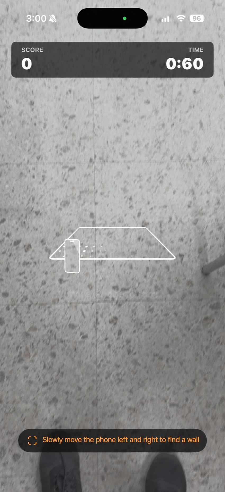 | 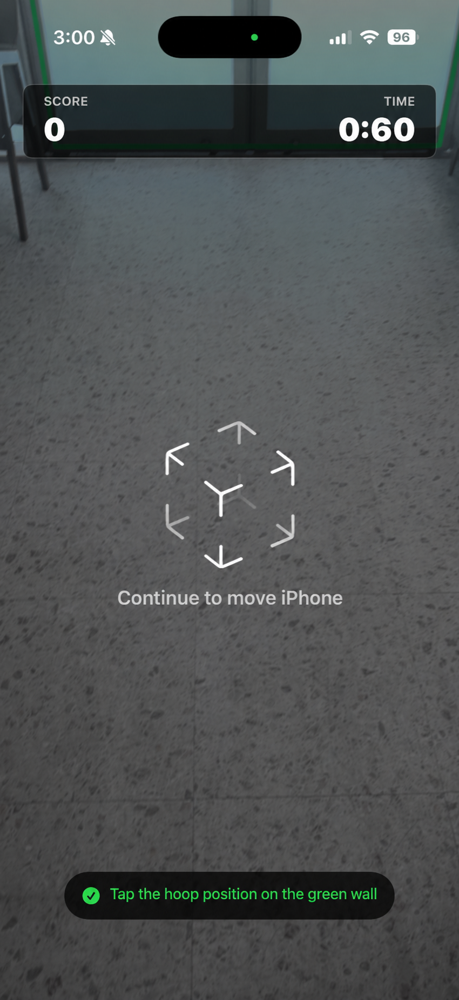 |  | 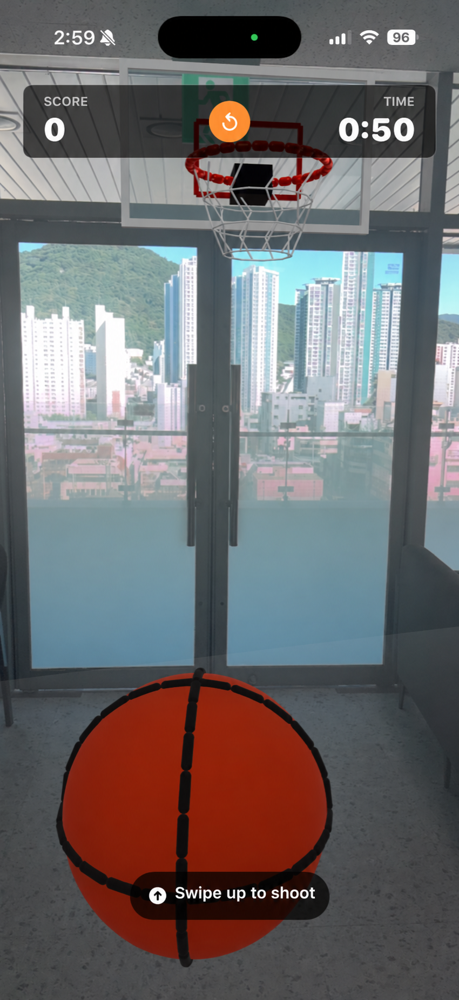 |

## Main features

- Real vertical wall recognition and goal placement
- Recognized wall visualization and AR scanning guidance
- Shoots that reflect the swipe direction and speed
- Physical collision of basketball, goalpost, and backboard
- Score judgment for passing the ring
- Scoreboard and 60 second timer
- Restart function to re-position the goalposts
- Shot correction and wide scoring range for beginners

## Requirements

- Xcode 16 or higher
- iOS 17 or higher
- A physical iPhone or iPad that supports ARKit
- Camera permission

AR games cannot be played on the simulator. You can build and do some testing, but to actually play you'll need an ARKit-enabled device.

## How to run

1. Point the camera at the wall and slowly move it left and right.
2. Tap the wall shown in green or the wall estimated by ARKit to place the goal.
3. Swipe up on the screen to throw the ball.

## How to operate

- **Goal Placement:** Tap on a recognized wall.
- **Shoot:** Swipe up on the screen.
- **Restart:** Press the small restart button on the top scoreboard and then tap the wall again.

## Technical configuration

-Swift
-SwiftUI
-ARKit
- RealityKit
-XCTest

No external libraries are used.

## 한국어

SwiftUI, ARKit, RealityKit으로 만든 iOS 증강현실 농구 게임 MVP입니다.

## 앱 아이콘

  

## 게임 화면

| 벽 스캔 | 위치 안내 | 벽 감지 | 게임 플레이 |
| --- | --- | --- | --- |
| 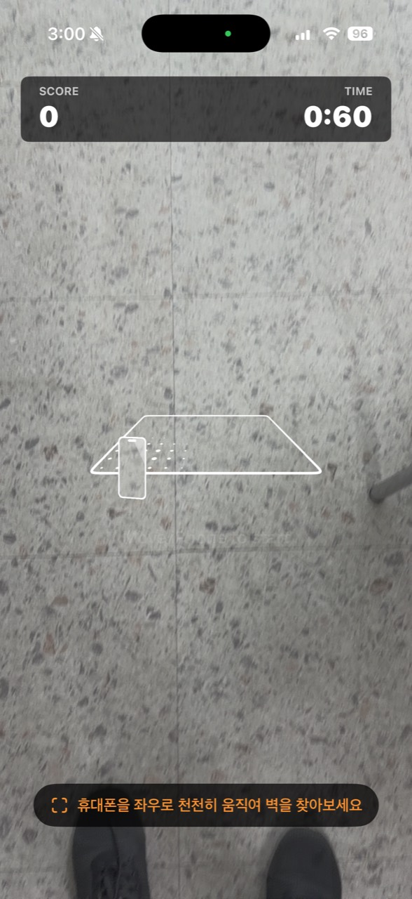 | 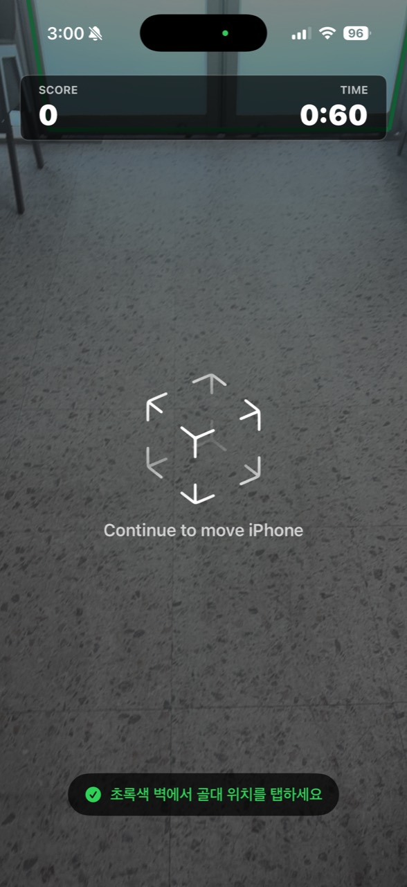 | 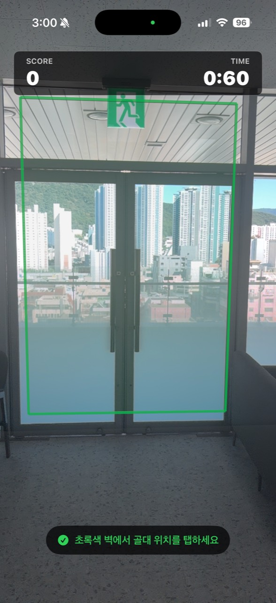 |  |

## 주요 기능

- 실제 수직 벽 인식 및 골대 배치
- 인식된 벽 시각화와 AR 스캔 안내
- 스와이프 방향과 속도를 반영한 슛
- 농구공, 골대, 백보드의 물리 충돌
- 링 통과 득점 판정
- 점수판과 60초 타이머
- 골대 위치를 다시 지정할 수 있는 재시작 기능
- 초보자를 위한 슛 보정과 넓은 득점 범위

## 요구 사항

- Xcode 16 이상
- iOS 17 이상
- ARKit을 지원하는 실제 iPhone 또는 iPad
- 카메라 권한

AR 게임은 시뮬레이터에서 플레이할 수 없습니다. 빌드와 일부 테스트는 가능하지만 실제 플레이에는 ARKit 지원 기기가 필요합니다.

## 실행 방법

1. 카메라를 벽에 향한 채 천천히 좌우로 움직입니다.
2. 초록색으로 표시된 벽 또는 ARKit이 추정한 벽을 탭해 골대를 배치합니다.
3. 화면을 위로 스와이프해 공을 던집니다.

## 조작 방법

- **골대 배치:** 인식된 벽을 탭합니다.
- **슛:** 화면을 위로 스와이프합니다.
- **다시 시작:** 상단 점수판의 작은 재시작 버튼을 누른 뒤 벽을 다시 탭합니다.

## 기술 구성

- Swift
- SwiftUI
- ARKit
- RealityKit
- XCTest

외부 라이브러리는 사용하지 않습니다.
